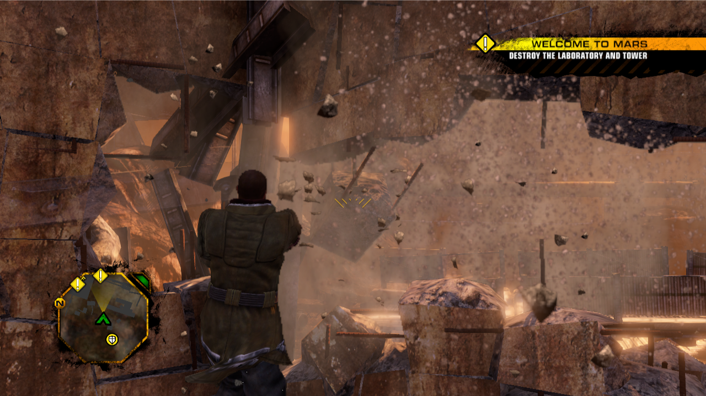

# Red Faction Guerrilla Re-Mars-tered Recomp



A static recompilation of the PC version of Red Faction Guerrilla Re-Mars-tered. The game executable
(126,987 functions) is lifted from 32-bit x86 to C with [pcrecomp](https://github.com/sp00nznet/pcrecomp)
and laid out using the PDB that ships with the GOG release: original source folders, original files,
original source order and real function names.

No game data is included. You need your own copy of the game (GOG, build 1.0_fix (79624)).

The aim is portability: the x86 executable as plain C that can be moved to other CPUs and platforms.
The method is the same as the [Dead Space 2 recomp](https://github.com/bifftannen1/Dead-Space-2-Recomp).

## Status
| | |
|---|---|
| Functions lifted | 126,987 (126,984 PDB procedures + 3 interior entries), no lift errors or unimplemented instructions |
| Names | 126,984 / 126,984 from the matching PDB |
| Source files | every function placed in its original file and source order |
| Exact build | the source tree compiles to objects identical to the flat code generator output, 204 / 204 units |
| Boots | game log identical to the original exe through start-up |
| Plays | menus, new game, opening cutscene, first mission, sledgehammer destruction |
| Sound | not tested: the test machine lacks the DirectX June 2010 XAudio runtime |

Known gaps:
- Lua script errors take a `longjmp` path that is not modelled yet. Normal Lua calls work.
- Guest SEH `__except` handlers are not run.
- Guest threads share one lock, so the recomp runs slower than the original.
- Only the start of the campaign has been played. Multiplayer is untested.

## Sources
| | |
|---|---|
| Executable | `rfg.exe`, GOG 1.0_fix (79624), sha256 `7a82d2d0f425af5e75d8ffbce12fac53eb5ca9cd812731ccf5a29697e906af0e` |
| PDB | `rfg.pdb` from the same install, sha256 `aebb037679f7420ebb105739dee5dec796ac337f5bf3e16a05c4131b302c4ab2`, GUID `30e5b4db-4072-4d10-ade7-99ed565d3945` age 2 |
| Recompiler | pcrecomp at `sdk/PCRECOMP_BASE.txt` plus `sdk/patches` |

## Building
Needs Windows 10/11, Python 3.10+, git, and Visual Studio 2022 Build Tools with the C++ and Clang components.
The source tree is deep, so clone with long paths enabled into a short folder:
```
git clone -c core.longpaths=true https://github.com/bifftannen1/Red-Faction-Guerrilla-Recomp C:\src\rfg-recomp
cd C:\src\rfg-recomp
python tools\build.py --exe "C:\GOG Games\Red Faction Guerrilla Re-Mars-tered\rfg.exe"
```
Copy `out\rfg_recomp.exe` and `out\rfg_host.dll` next to your `rfg.exe` and run `rfg_recomp.exe`.
Keep the original `rfg.exe` there; its bytes are mapped as the guest image.
`--profile fast` builds with `-O2`, non-volatile guest memory and register locals.

## Layout
- `src/` holds the lifted code, one file per original source file, under `src/rfg`, `src/havok_*` and `src/msvc_*`.
- `units/` is build glue. Each `units/rfg_NNNN.c` includes a set of `src/` files to rebuild one compile unit.
- `include/` holds C++ headers generated from the PDB's type records.
- `config/` holds the tables derived from the PDB (names, placements, source roots).
- `tools/`, `probes/` and `host/` hold the build, the generation pipeline and the host runtime.
- `sdk/` holds the pcrecomp base revision and the patches applied to it.

## How it works
- Function list: every procedure in the PDB at its exact extent. Direct calls into a function's own body
  (MSVC `__finally` funclets) become interior entries.
- Code generation: `tools/rfg_codegen.py` lifts each function with pcrecomp `lift32`. Switch tables are bounded
  by their guard and noreturn functions are computed.
- Source tree: `tools/organize_rfg.py` files every function under its original path, in source order.
- Runtime: pcrecomp `native32`. Imports are bound to the real DLLs and guest code runs at its original address,
  0x00400000. Under WOW64 that range cannot be reserved after process start, so `rfg_recomp.exe` is a 2 KB stub
  whose first section is the reservation. It loads `rfg_host.dll`, which maps the game into it.

## PDB annotations and headers
Everything the PDB records for an address is attached to the lifted code at that address.
- Functions are named from their PDB names (`rl_draw::rl_draw` becomes `rl_draw__ctor`; overloads get the
  address as a suffix). `units/rfg_names.h` maps each name back to its `sub_XXXXXXXX` symbol, so the
  compiled objects are unchanged.
- Comments carry the rest: `// line N` from the line records, names for globals and functions in operands
  (`// 0x1cd16f8=rl_singleton<rl_draw>::ms_instance_p`), parameters and locals where the stack offset is known
  (`// [esp+0xc]=conn`), imports, indirect call prototypes, virtual calls (`// vcall rl_draw::render [slot 0x10]`),
  and the prototype and frame of each function.
- `include/rfg_types.hpp` lays out every struct, class, union and enum in the PDB (18,824 + 4,581) at its recorded
  offsets, checked by `static_assert`. `include/rfg_protos.hpp` declares 125,727 of the 126,987 functions.

`tools/verify_pdb_annot.py` checks every annotation against a second PDB reader. Coverage figures are in
`config/pdb_annot/receipt.json` and `include/headers_receipt.json`.

## Regenerating from the PDB
With `rfg.pdb`, run in order: `probes/pdb_procs32.py`, `probes/pdb_alloc32.py`, `tools/rfg_codegen.py`,
`tools/write_names.py`, `tools/annotate_pdb.py build`, `tools/organize_rfg.py --annotate`, `tools/pdb_headers.py`,
then `tools/verify_all.py`. Each step prints a DONE marker or stops with an error.
